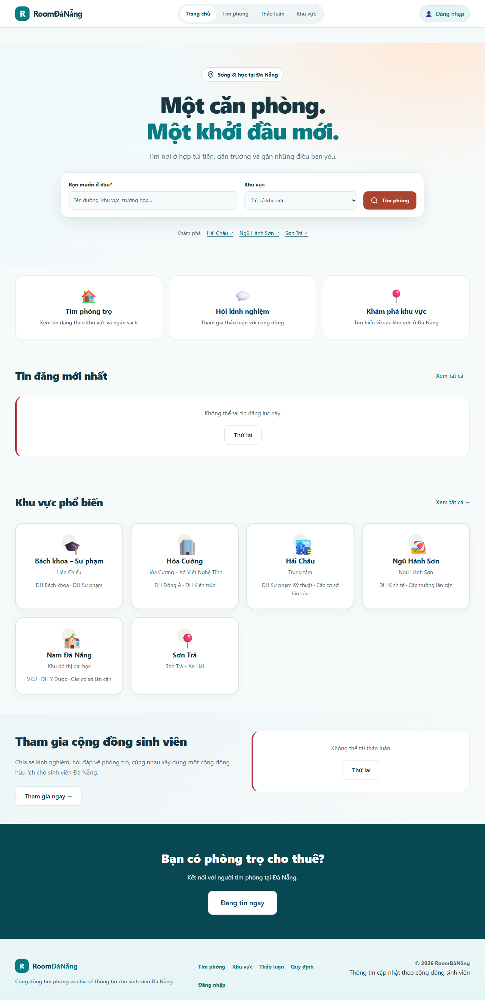
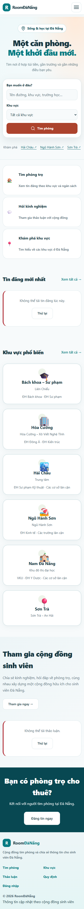
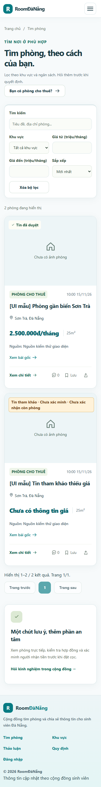

# Room Đà Nẵng

**Tìm phòng trọ, khám phá khu vực và kết nối với cộng đồng sinh viên tại Đà Nẵng.**

Room Đà Nẵng là nền tảng web giúp người thuê tìm kiếm phòng trọ theo nhu cầu, chủ trọ quản lý tin đăng và mọi người chia sẻ kinh nghiệm sống tại thành phố. Dự án kết hợp bảng tin phòng với khu vực thảo luận, hướng đến trải nghiệm rõ ràng và hữu ích trên cả máy tính lẫn điện thoại.

> Đây là README giới thiệu và hướng dẫn phát triển dự án. Các thông tin về môi trường production sẽ được bổ sung khi có URL và kênh hỗ trợ chính thức.

## Khám phá sản phẩm

| Trải nghiệm | Mô tả |
| --- | --- |
| **Tìm phòng** | Duyệt tin đăng và khám phá phòng theo khu vực. |
| **Khám phá địa phương** | Tìm hiểu các cụm khu vực và nội dung liên quan. |
| **Thảo luận cộng đồng** | Đặt câu hỏi, chia sẻ kinh nghiệm thuê và sinh sống. |
| **Quản lý tin đăng** | Chủ trọ tạo, cập nhật và theo dõi tin phòng của mình. |
| **Tài khoản cá nhân** | Đăng nhập, quản lý hồ sơ, tin đã lưu và hoạt động. |
| **Quản trị nội dung** | Công cụ quản lý tin đăng, tài khoản, cấu hình và quy trình duyệt. |

## Công nghệ

- **Ứng dụng:** Next.js 16, React 19, TypeScript
- **Cơ sở dữ liệu:** MySQL 8+ hoặc MariaDB 10.11+
- **Kiểm thử trình duyệt:** Playwright
- **Môi trường chạy:** Node.js 22.13+ và npm

## Giao diện

Thiết kế nền sáng, xanh biển/teal và điểm nhấn cam san hô. Tìm kiếm ngay trên
trang chủ; lọc giá/khu vực, sắp xếp và phân trang 10 phòng. Tin tham khảo có
nhãn chưa xác minh, không tự khẳng định còn phòng hoặc hiển thị ảnh chưa rõ quyền
sử dụng. Thao tác lưu, gửi bình luận và cập nhật lịch có phản hồi tại chỗ.



| Mobile | Thẻ phòng — dữ liệu kiểm thử trong bộ nhớ |
| --- | --- |
|  |  |

Ảnh trước/sau tại [docs/screenshots](docs/screenshots/). Ảnh `fixture-*` dùng
dữ liệu kiểm thử trong trình duyệt, không phải tin công khai. Ảnh trang thật
đang thể hiện trạng thái khách hoặc lỗi database ở môi trường kiểm tra.
Xem [báo cáo UI và giới hạn kiểm thử](docs/ui-review.md).

## Chạy local

### 1. Chuẩn bị

Cài Node.js 22.13 trở lên, npm và MySQL/MariaDB. Tạo một database riêng cho môi trường phát triển.

### 2. Cài dependency và cấu hình môi trường

```bash
npm ci
```

Tạo `.env.local` từ file mẫu:

```bash
cp .env.example .env.local
```

Trên Windows PowerShell, dùng:

```powershell
Copy-Item .env.example .env.local
```

Thiết lập các biến cần thiết trong `.env.local`:

| Biến | Mục đích |
| --- | --- |
| `MYSQL_URL` | Chuỗi kết nối database |
| `ADMIN_EMAIL` | Email tài khoản quản trị ban đầu |
| `ADMIN_PASSWORD` | Mật khẩu quản trị ban đầu |
| `ADMIN_SESSION_SECRET` | Secret ký session quản trị |
| `USER_SESSION_SECRET` | Secret ký session người dùng |

Tạo secret ngẫu nhiên đủ mạnh cho môi trường của bạn. Không dùng các giá trị mẫu trong `.env.example` ở production và không commit `.env.local`.

### 3. Khởi tạo và chạy

```bash
npm run db:init
npm run doctor
npm run dev
```

Mở [http://localhost:3000](http://localhost:3000).

Nếu development với Turbopack bị lặp tải lại trên Windows, có thể dùng Webpack:

```bash
npm run dev -- --webpack --hostname 127.0.0.1 --port 3033
```

Lệnh này không sửa cấu hình database. Chỉ chạy `db:init` cho database mới;
không khởi tạo lại database đang có dữ liệu để xử lý lỗi kết nối.

## Build production

```bash
npm run doctor
npm run build
npm run start
```

Lệnh `build` tạo production build và chuẩn bị gói standalone. `start` chạy ứng dụng từ gói này.

## Chạy bằng Docker

Yêu cầu Docker và Docker Compose đã được cài đặt:

```bash
npm run stack:up
npm run stack:status
```

Một số lệnh quản lý stack:

```bash
npm run stack:logs
npm run stack:down
```

## Lệnh thường dùng

| Lệnh | Tác dụng |
| --- | --- |
| `npm run dev` | Chạy máy chủ phát triển |
| `npm run build` | Tạo production build |
| `npm run start` | Chạy production build |
| `npm run doctor` | Kiểm tra cấu hình và môi trường |
| `npm run typecheck` | Kiểm tra kiểu TypeScript |
| `npm test` | Chạy bộ test mặc định |
| `npm run test:integration` | Chạy kiểm thử integration chính |
| `npm run test:browser` | Chạy kiểm thử trình duyệt chính |

Repo cũng có các lệnh test và migration chuyên biệt; xem phần `scripts` trong [package.json](./package.json) để tra cứu.

### Kiểm tra giao diện không ghi database

Khởi động local trước, rồi chạy (mặc định localhost:3033 và Microsoft Edge):

```bash
node tests/browser/ui-redesign.cjs
```

Test này duyệt 9 trang ở 375/768/1280px, quét axe WCAG A/AA, kiểm tra tin tham khảo,
tìm kiếm, lưu tin, bình luận, hủy lịch và thông báo. Các mutation của fixture được
trả lời trong bộ nhớ; mutation tới API thật bị chặn. Ảnh lưu tại
`docs/screenshots/after/`. Có thể đặt `TEST_BASE_URL`, `CHROMIUM_PATH` và
`TEST_SCREENSHOT_DIR` để đổi server local, trình duyệt và thư mục ảnh.

### Kiểm thử nghiệp vụ trên database QA

`npm run test:pages`, `npm run test:browser` và các test tính năng có tạo/sửa/xóa
dữ liệu. Chỉ trỏ `TEST_BASE_URL` đến server dùng database QA tách biệt.
`test:pages` yêu cầu `TEST_ISOLATED_DB=1`; `test:browser` cần `TEST_ADMIN_EMAIL`
và `TEST_ADMIN_PASSWORD` của QA. Các test tính năng có thể cần fixture từ bước
integration tương ứng. Không đặt các biến này chỉ để vượt kiểm tra bảo vệ.

Repo hiện không có script `lint`. Quy trình kiểm tra: `npm run typecheck`,
`npm test`, `npm run build`, `npm run doctor`, rồi các test trình duyệt trên QA.

## Cấu trúc dự án

```text
app/
  <route>/        Trang, layout và component riêng của route
  api/            HTTP API route handlers
components/       Component giao diện dùng chung
lib/
  client/         Tiện ích phiên và xác thực phía trình duyệt
  data/           Dữ liệu miền dùng chung cho giao diện và backend
  server/         Xác thực, nghiệp vụ, database và lưu trữ phía server
    collector/    Thu thập và phân tích nguồn dữ liệu
  shared/         Tiện ích dùng chung giữa client và server
  policies/       Quy tắc kiểm tra và phân loại dữ liệu
  types/          Kiểu dữ liệu dùng chung
data/             JSON, CSV, cache và fixture dữ liệu
database/         Schema, migration, seed và hợp đồng database
scripts/db/       Lệnh khởi tạo, nâng cấp và xuất dữ liệu
public/           Tài nguyên tĩnh
tests/            Kiểm thử unit, integration và trình duyệt
docs/screenshots/  Ảnh trước/sau, tách trang thật và fixture UI
```

`app/` được giữ theo quy ước App Router của Next.js: trang và API phải nằm tại đây để URL không thay đổi. Giao diện dùng chung nằm trong `components/`, tiện ích trình duyệt trong `lib/client/`. API route là lớp nhận/trả HTTP; xử lý backend nằm trong `lib/server/`. Dữ liệu đầu vào và fixture đặt trong `data/`, còn schema và migration nằm trong `database/`.

## An toàn dữ liệu và vận hành

- Không đưa credential, session secret hoặc dữ liệu cá nhân vào Git.
- Dùng database riêng cho phát triển và kiểm thử; kiểm tra tác động trước khi chạy test có ghi hoặc xóa dữ liệu.
- Trước khi cập nhật schema, xác định migration phù hợp trong `scripts/` và sao lưu dữ liệu cần thiết.
- Chỉ bật nguồn thu thập dữ liệu mà bạn có quyền sử dụng; cấu hình các biến liên quan trong `.env.local`.
- Không bật dữ liệu demo trên dịch vụ công khai.

## Đóng góp

1. Tạo branch riêng cho thay đổi.
2. Giữ thay đổi tập trung và theo quy ước hiện có của dự án.
3. Chạy các kiểm tra phù hợp, tối thiểu là `npm run typecheck` và `npm run build` khi thay đổi mã ứng dụng.
4. Mô tả rõ mục đích, cách kiểm thử và ảnh chụp giao diện nếu thay đổi UI.

## Giấy phép và liên hệ

Thông tin giấy phép và kênh liên hệ chính thức chưa được khai báo trong repository. Vui lòng xác nhận với chủ dự án trước khi tái sử dụng hoặc phân phối mã nguồn.
