# Bổ sung sửa layout các form động

## Kết quả

Đã sửa ba nhóm lỗi và một form cùng kiểu phát hiện khi rà mã:

| Màn hình/trạng thái | Vấn đề | Sửa |
|---|---|---|
| Admin → Thu thập tin → Cào thử URL | Hai nhóm trường không dùng wrapper field; URL không có giới hạn chiều rộng; nút, thống kê và chú thích tự chạy thiếu khoảng cách; chú thích tự chạy nằm chung hàng hẹp | Dùng `FormField`, `form-grid` và `toolbar`; URL tối đa 720 px, trường trang tối đa 240 px, gap theo token 4–24 px; tách ghi chú tự chạy xuống dưới checkbox. Nút Phân tích URL giữ disabled hợp lệ khi URL trống và vẫn có chỉ báo trạng thái dễ đọc. |
| Admin → Quản lý bài | Bộ lọc mặc định chiếm cả dòng và dùng cỡ compact 36 px; nhóm nút thao tác và phân trang thiếu gap; checkbox chưa căn giữa với nội dung | Bộ lọc desktop dùng 40 px, ô tìm kiếm flex 280–420 px, select tối thiểu 180 px; mobile xếp dọc; action/pagination dùng nhóm nút gap 8 px; thêm khoảng cách cho thống kê và “Chọn tất cả”. |
| Cộng đồng → Viết thảo luận | Label và control thiếu wrapper layout, textarea thấp, trường chủ đề/khu vực không nằm trong grid, panel/form quá rộng | Chuyển bốn trường sang `FormField`; panel tối đa 640 px, label cách control 6 px, input/select 40 px, radius 8 px, textarea tối thiểu 120 px; grid hai cột ở màn lớn và một cột trên mobile; footer wrap không chồng lấn. |
| Admin → Thu thập từ HTML → Thêm nguồn HTML mới (phát hiện thêm) | Tám `form-group` chỉ có label và control rời, không dùng layout field dùng chung | Chuyển tám nhóm thành `FormField`, bố trí `form-grid` đáp ứng và nút submit căn đầu hàng. |
| Admin → Cộng đồng (phát hiện thêm) | Cặp Trang trước/Trang sau cũng dùng `button-row` không có khoảng cách | Gắn `btn-group` dùng gap 8 px. |

Shared layout primitives `FormField`, `.form-grid`, `.toolbar` và `.btn-group` được dùng lại. Không đổi nghiệp vụ/API/dữ liệu; không dùng `!important` mới.

## Rà soát mã nguồn

- Tìm các `<label>`, `input`, `select`, `textarea`, `.form-group`, `.form-row`, `button-row` và nhóm action trong `app/` và `components/`.
- Các form có layout riêng hiện hữu gồm `AuthForm`/`LoginModal` (`.modal-form`), đăng phòng (`.listing-form`), bộ lọc cộng đồng/phòng (`.explorer-filters`), lịch xem/tin nhắn (`.visit-request`, `.chat-compose`), cài đặt admin và danh sách người dùng. Các selector hiện hữu của chúng đã đặt label theo cột/grid và được bộ audit trang kiểm tra; không còn `.form-group` trong JSX/TSX sau sửa.
- Những nhóm action dùng chung `.inline-actions`, `.management-actions`, `.editor-actions` vốn đã có gap; bổ sung `.btn-group` cho hai nhóm phân trang admin trước/sau chưa có.

## Kiểm thử

Playwright mở 28 trang ở 5 viewport (140 lượt): 360×640, 390×844, 768×1024, 1366×768, 1920×1080. Mở thêm sáu tab admin và composer thành 35 trạng thái động (7 × 5). Vì vậy bộ sau sửa báo **175/175 lượt đạt**, 0 lỗi. Các assertion mới kiểm tra:

- wrapper `ui-field`, nhãn nằm trước control, chiều rộng desktop tối thiểu 240 px và chiều cao thống nhất;
- kích thước/chiều rộng, placeholder không bị tràn, khoảng cách giữa field, action, phân trang, ghi chú và thống kê;
- bounding box giữa các control và ghi chú không giao nhau;
- composer grid 1/2 cột, footer wrap, textarea, chiều rộng panel;
- danh sách Quản lý bài có dữ liệu và trạng thái bộ lọc rỗng.

| Giai đoạn | Lượt | Lượt lỗi | Kết quả assertion mục tiêu |
|---|---:|---:|---|
| Baseline trước sửa | 175 | 23 | 15 trạng thái động ở collector, Quản lý bài và composer phát hiện 84 lỗi bố cục. Tám lượt lỗi còn lại là kiểm tra inbox/lịch xem bị ảnh hưởng vì fixture baseline thay session; test đã bỏ thao tác đó. |
| Sau sửa | 175 | 0 | 0 assertion lỗi |

Sáu tab admin được mở và xác nhận kích hoạt; assertion hình học tập trung vào tab Collector, Listings, HTML-source form và composer. Listing được kiểm tra cả trạng thái có dữ liệu lẫn lọc rỗng. Mạng/DB test chỉ dùng fixture QA trên máy cục bộ.

## Ảnh trước/sau

Các ảnh đầy đủ cho 390, 768, 1366 và 1920 px nằm tại `docs/screenshots/dynamic-layout/{before,after}/`.

| Màn hình, viewport | Trước | Sau |
|---|---|---|
| Cào thử URL, mobile 390 px | 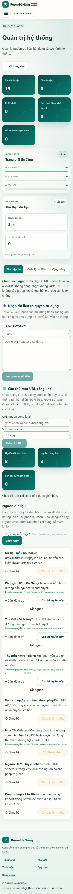 | 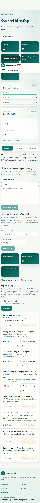 |
| Cào thử URL, desktop 1366 px | 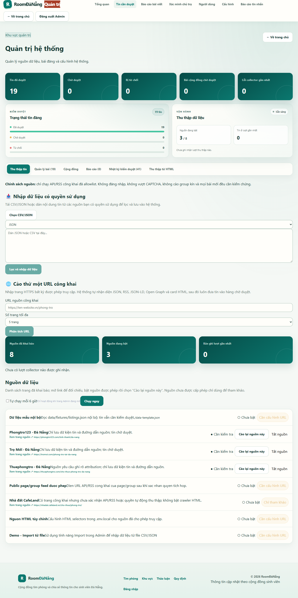 | 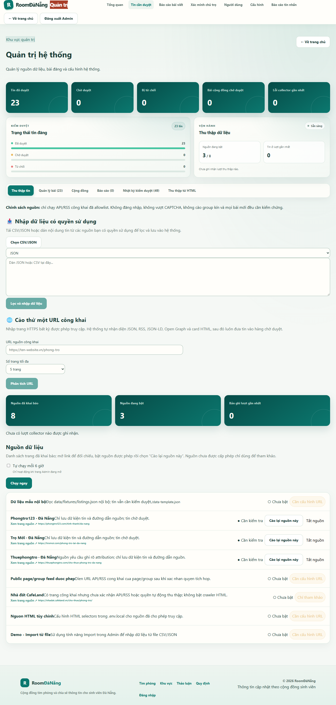 |
| Quản lý bài, mobile 390 px | 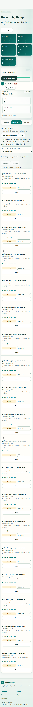 | 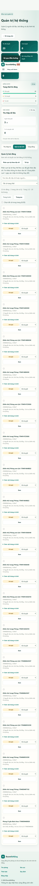 |
| Quản lý bài, desktop 1366 px | 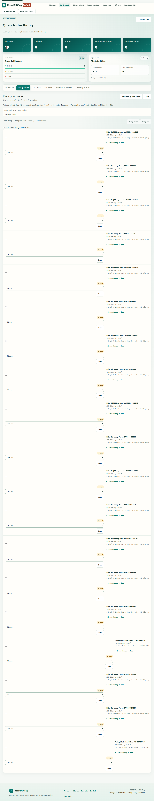 | 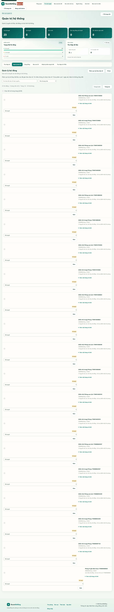 |
| Viết thảo luận, mobile 390 px | 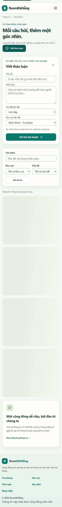 | 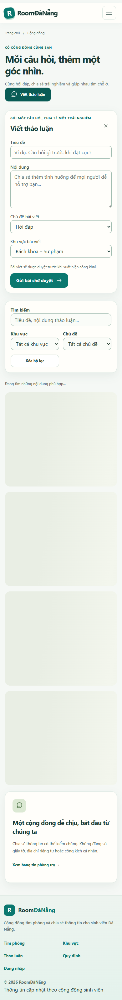 |
| Viết thảo luận, desktop 1366 px | 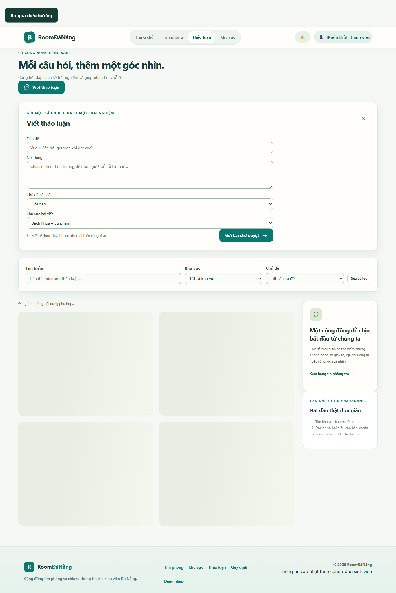 | 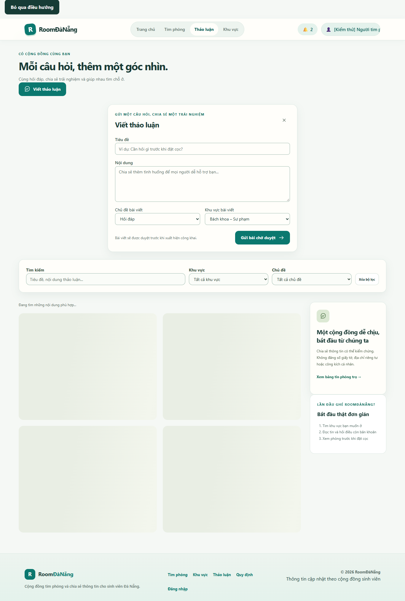 |

## Build và test

- `npm run typecheck`: đạt.
- `npm test`: 62/62 đạt.
- `npm run build`: đạt sau khi chạy lại qua nhắc nhở bảo mật của Next.js. Build vẫn cảnh báo Next.js 16.4.3 thuộc phiên bản có security advisory; cần xử lý nâng cấp riêng.
- `npm run test:layout`: 175/175 lượt đạt.
- Repo không định nghĩa script lint.

Các commit được chia theo lỗi collector/form chung, admin listings và composer. PR #6 vẫn mở; không merge, deploy hay truy cập Railway/database production.
