# Báo cáo chuẩn hóa trường nhập liệu và khoảng cách

## Phạm vi

Chuẩn hóa chiều cao, cỡ chữ, padding và bo góc của input/select/textarea; gom nhãn trường vào `FormField` ở trang chủ và bộ lọc bảng tin; thiết lập thang spacing 4/8 px; bỏ hai nhóm CSS cũ ghi đè kích thước trường. Không đổi logic nghiệp vụ, API hay dữ liệu.

## Ma trận giao diện

Playwright đã chụp và kiểm tra 28 trang ở 5 kích thước (140 lượt): 360×640, 390×844, 768×1024, 1366×768 và 1920×1080. Trong 345 trường được đo: trước sửa có 20 mức chiều cao và 10 mức font; sau sửa các trường đơn dòng dùng 40 px (18 trường lọc admin gọn dùng 36 px), font 14 px trên màn lớn và 16 px trên mobile, radius thống nhất 12 px. Textarea giữ chiều cao nội dung linh hoạt, mức tối thiểu 88 px. Tất cả 140 lượt không ghi nhận control ẩn hoặc lỗi bố cục trong audit.

| Route trong audit | Vai trò | 360×640 | 390×844 | 768×1024 | 1366×768 | 1920×1080 |
|---|---|---|---|---|---|---|
| `/` (home) | Khách | PASS | PASS | PASS | PASS | PASS |
| `/bang-tin` (feed) | Khách | PASS | PASS | PASS | PASS | PASS |
| `/bai/[id]` (room detail) | Sinh viên | PASS | PASS | PASS | PASS | PASS |
| `/bai/[id]` (discussion-detail fixture) | Sinh viên | PASS | PASS | PASS | PASS | PASS |
| `/thao-luan` (community) | Khách | PASS | PASS | PASS | PASS | PASS |
| `/khu-vuc` (areas) | Khách | PASS | PASS | PASS | PASS | PASS |
| `/cum` (clusters) | Khách | PASS | PASS | PASS | PASS | PASS |
| `/cum/hai-chau` (cluster) | Khách | PASS | PASS | PASS | PASS | PASS |
| `/quy-dinh` (rules) | Khách | PASS | PASS | PASS | PASS | PASS |
| `/dang-nhap` (login) | Khách | PASS | PASS | PASS | PASS | PASS |
| `/dang-ky` (register) | Khách | PASS | PASS | PASS | PASS | PASS |
| `/profile` | Sinh viên | PASS | PASS | PASS | PASS | PASS |
| `/bai-viet-cua-toi` (my-posts) | Sinh viên | PASS | PASS | PASS | PASS | PASS |
| `/thong-bao` (notifications) | Sinh viên | PASS | PASS | PASS | PASS | PASS |
| `/tin-nhan` (inbox) | Sinh viên | PASS | PASS | PASS | PASS | PASS |
| `/tin-nhan?hoi-thoai=…` (visit-form) | Sinh viên | PASS | PASS | PASS | PASS | PASS |
| `/lich-xem-phong` (appointments) | Sinh viên | PASS | PASS | PASS | PASS | PASS |
| `/dang-phong` (create-room) | Chủ trọ | PASS | PASS | PASS | PASS | PASS |
| `/quan-ly-phong` (manage-rooms) | Chủ trọ | PASS | PASS | PASS | PASS | PASS |
| `/quan-ly-phong/[id]` (manage-room) | Chủ trọ | PASS | PASS | PASS | PASS | PASS |
| `/admin` | Admin | PASS | PASS | PASS | PASS | PASS |
| `/admin` (admin-listings) | Admin | PASS | PASS | PASS | PASS | PASS |
| `/admin` (admin-reports) | Admin | PASS | PASS | PASS | PASS | PASS |
| `/admin/chu-tro` (admin-landlords) | Admin | PASS | PASS | PASS | PASS | PASS |
| `/admin/nguoi-dung` (admin-users) | Admin | PASS | PASS | PASS | PASS | PASS |
| `/admin/cau-hinh` (admin-settings) | Admin | PASS | PASS | PASS | PASS | PASS |
| `/admin/tin-nhan` (admin-chat) | Admin | PASS | PASS | PASS | PASS | PASS |
| Not found (404) | Khách | PASS | PASS | PASS | PASS | PASS |

Kết quả đo đầy đủ, bao gồm kích thước và trạng thái hiển thị từng control, nằm trong `work/ui-polish-evidence/after/results.json` của workspace. Màn admin có thêm ảnh chụp trạng thái menu mở trên mobile.

## Ảnh so sánh

### Trang tìm phòng

| Trước | Sau |
|---|---|
| 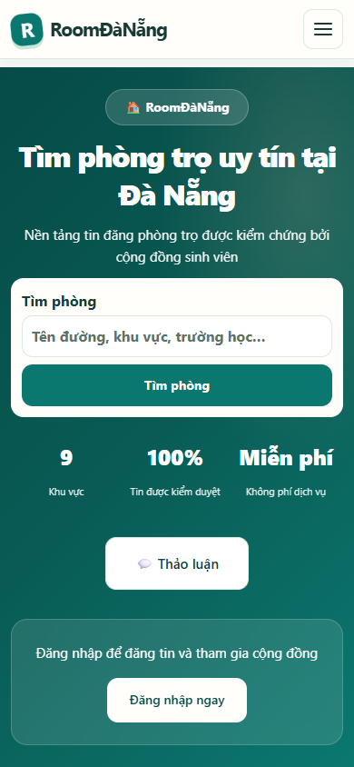 | 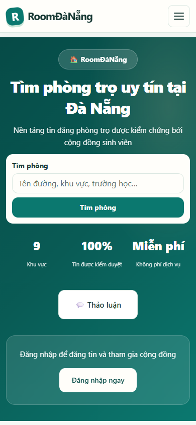 |
| 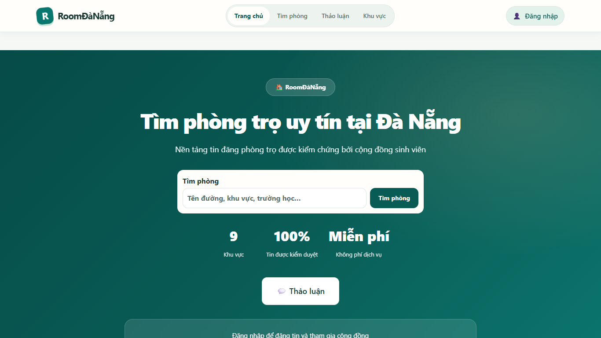 | 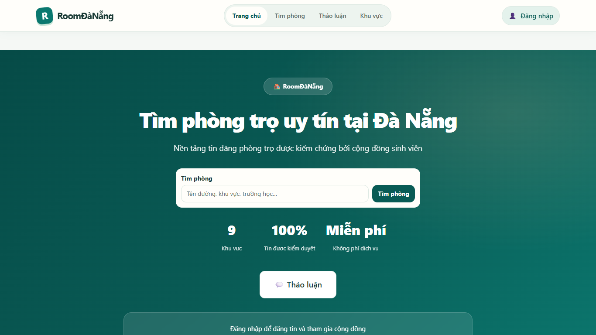 |

### Chi tiết phòng

| Trước | Sau |
|---|---|
| 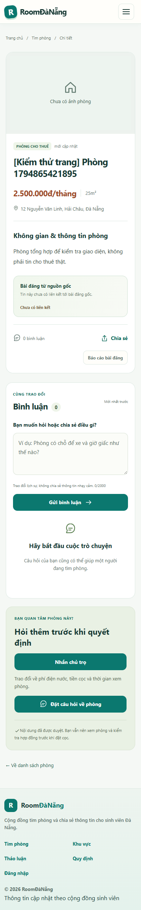 | 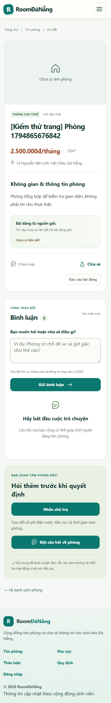 |

### Đặt lịch xem

| Trước | Sau |
|---|---|
| 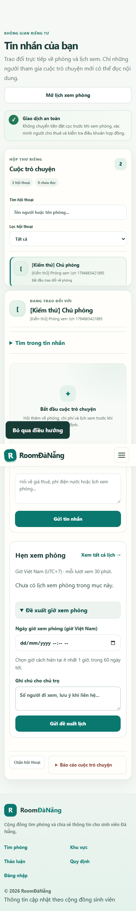 | 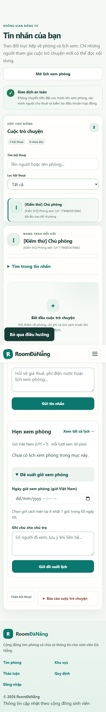 |

### Dashboard và bảng admin

| Trước | Sau |
|---|---|
|  | 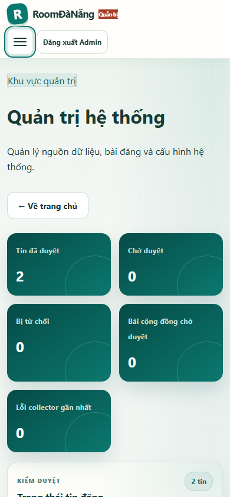 |
| 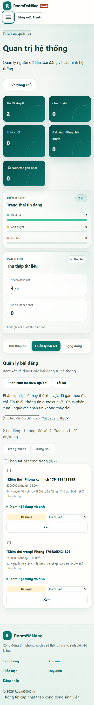 | 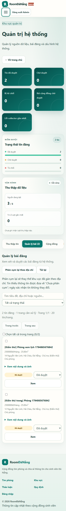 |

## Xác minh

- `npm run typecheck`: PASS.
- `npm test`: PASS, 62/62.
- `npm run build`: PASS; Next.js hoàn tất compile, TypeScript, prerender 52 trang và đóng gói standalone.
- Playwright layout audit: PASS, 140/140 lượt, 345 controls đo, 0 issue.
- Repo hiện không khai báo script lint.
- Next.js 16.4.3 hiển thị cảnh báo advisory bảo mật trong build; cần nâng cấp Next.js riêng.

## Lỗi và cách sửa

Trước sửa, 345 control phân tán ở 20 mức chiều cao (21–169.3 px), 10 mức font và bốn mức radius. Hai quy tắc CSS tổng quát trong `redesign.css` cùng quy tắc auth trong `experience.css` xung đột với kích thước giữa các trang. Thay bằng stylesheet dùng chung có token và ngoại lệ compact có phạm vi, đồng thời xóa các quy tắc kích thước cũ. Sau sửa không phát hiện trường bị ẩn trong ma trận.

Các lượt build đầu tiên trong Windows sandbox không tạo được junction của Turbopack. Chạy lại trong worktree với quyền filesystem cho artifact build cục bộ thì hoàn tất. Không có lệnh nào kết nối Railway hoặc production database.

